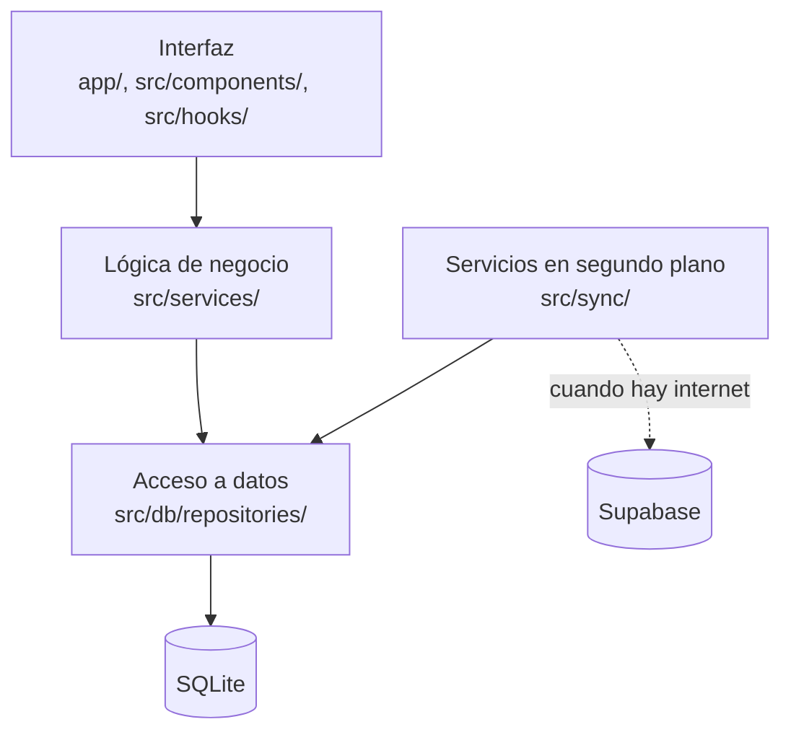

# Arquitectura offline-first · ConsoleControl Mobile

| Campo | Valor |
|---|---|
| Tarea | T01 (TW-1) · Definir arquitectura offline-first y convenciones técnicas |
| Autor | Victor Narciso Mamani Anahua (VN) |
| Fecha | 21/10/2026 |
| Estado | Pendiente de aprobación |
| Alcance | Capas, estructura de carpetas, uso de Zod, Zustand y TanStack Query, y decisión sobre el tiempo de las sesiones |

## 1. Resumen y decisiones principales

| # | Decisión | Detalle | ADR |
|---|---|---|---|
| D1 | Expo y TypeScript | React Native con Expo, TypeScript estricto y Expo Router | [0001](../adr/0001-expo-react-native.md) |
| D2 | SQLite | Base de datos local con `expo-sqlite` | [0002](../adr/0002-sqlite-fuente-de-verdad.md) |
| D3 | SQLite como fuente de verdad | El dispositivo manda; la nube nunca es la fuente. La hora de inicio de la sesión se guarda y el tiempo se calcula | [0002](../adr/0002-sqlite-fuente-de-verdad.md), [0003](../adr/0003-hora-de-inicio-persistida.md) |
| D4 | Drizzle | Drizzle ORM sobre `expo-sqlite` y migraciones con `drizzle-kit` | [0004](../adr/0004-drizzle-orm.md) |
| D5 | Zod y React Hook Form | Un solo esquema valida formularios y datos | [0007](../adr/0007-zod-react-hook-form.md) |
| D6 | Zustand y TanStack Query | Zustand para estado de interfaz; TanStack Query para datos | [0005](../adr/0005-estado-zustand-tanstack-query.md) |
| D7 | NativeWind | Estilos con clases de Tailwind | [0006](../adr/0006-nativewind.md) |
| D8 | Supabase unidireccional | Respaldo dispositivo → nube (HU-008), sin resolución de conflictos | [0008](../adr/0008-supabase-respaldo-unidireccional.md) |
| D9 | Sin login en el MVP | Un operador por dispositivo (Observación O1) | [0009](../adr/0009-sin-login-en-el-mvp.md) |

## 2. Arquitectura en capas



| Capa | Carpeta | Responsabilidad | No debe hacer |
|---|---|---|---|
| Interfaz | `app/`, `src/components/`, `src/hooks/`, `src/stores/` | Mostrar pantallas, recibir acciones y guardar estado de pantalla | Importar `expo-sqlite` o `drizzle-orm`, escribir consultas o calcular cobros |
| Lógica de negocio | `src/services/`, `src/schemas/` | Reglas del negocio: tiempo, tarifas, estados de sesión y validación | Dibujar interfaz o escribir consultas |
| Acceso a datos | `src/db/` (`repositories/`, `schema/`, `migrations/`) | Leer y escribir en SQLite con Drizzle; único lugar con consultas | Contener reglas de negocio o conocer pantallas |
| Servicios en segundo plano | `src/sync/` | Subir a Supabase los registros pendientes cuando hay internet | Bloquear la operación local o saltarse los repositorios |

**Regla de dependencias.** La Interfaz usa la Lógica de negocio, la Lógica de negocio usa el Acceso a datos y el Acceso a datos usa SQLite. Nunca en sentido contrario.

**Flujo offline-first.**
1. Toda escritura va primero a SQLite con `sync_status = 'pendiente'`.
2. Con internet, `src/sync/` sube los pendientes a Supabase y los marca `'sincronizado'`.
3. Sin internet la app funciona igual.

**Cómo encajan Zod, TanStack Query y Zustand.**
- La Interfaz usa hooks de TanStack Query (`src/hooks/`) que llaman a los servicios.
- Zod valida en el formulario y de nuevo en el servicio, antes de llegar a la capa de datos. Los esquemas viven en `src/schemas/`.
- Zustand queda solo en la Interfaz (`src/stores/`) y no guarda datos de negocio.

## 3. Estructura de carpetas

```
consolecontrol-mobile/
├── AGENTS.md
├── CLAUDE.md
├── CONTRIBUTING.md
├── app/                      # Pantallas (Expo Router)
├── src/
│   ├── components/           # Componentes reutilizables de interfaz
│   ├── hooks/                # Hooks de React, incluidos los de TanStack Query
│   ├── stores/               # Stores de Zustand (solo estado de interfaz)
│   ├── services/             # Lógica de negocio
│   ├── schemas/              # Esquemas Zod compartidos
│   ├── db/
│   │   ├── schema/           # Tablas de Drizzle
│   │   ├── migrations/       # Migraciones generadas por drizzle-kit
│   │   ├── repositories/     # Funciones de acceso a SQLite
│   │   ├── client.ts         # Apertura de la base de datos
│   │   └── seed.ts           # Consolas y mandos iniciales
│   ├── sync/                 # Sincronización con Supabase (HU-008)
│   ├── utils/                # Funciones auxiliares sin estado
│   └── types/                # Tipos de TypeScript
├── __tests__/                # Pruebas
├── docs/
│   ├── README.md
│   ├── architecture/
│   ├── adr/
│   ├── roadmap/
│   ├── guides/
│   └── specs/
└── .github/
    └── pull_request_template.md
```

**Quién trabaja dónde**

| Responsable | Carpetas |
|---|---|
| RF | `app/`, `src/components/`, `src/hooks/`, `src/stores/` |
| VM | `src/db/`, `src/services/`, `src/sync/`, `src/schemas/` (en coordinación con RF) |
| VN | `docs/`, `.github/` y la configuración de la raíz |

**Convenciones de nombres**
- Componentes: `PascalCase.tsx`.
- Todo lo demás: `camelCase.ts`.
- Tablas y columnas de SQLite: `snake_case`.
- Migraciones: las genera drizzle-kit y no se renombran.

## 4. Decisión sobre el tiempo de las sesiones

**Problema.** Un contador en memoria se pierde si se cierra la app, el sistema la detiene o el celular se reinicia, y eso causa cobros incorrectos.

**Decisión.**
1. Al iniciar se guarda `started_at` (milisegundos Unix) y estado `activa` en SQLite.
2. El tiempo transcurrido nunca se guarda como contador; se calcula como `ahora − started_at`.
3. La pantalla refresca cada segundo solo para mostrar.
4. Al cerrar se guardan `ended_at`, el tiempo total y el monto.

**Pseudocódigo en TypeScript.** Las funciones de tiempo reciben la hora como parámetro para poder probarlas.

```ts
// src/services/sessionTimer.ts
export function elapsedMs(session: Session, now = Date.now()): number {
  return now - session.startedAt;
}

export function remainingMs(session: Session, now = Date.now()): number {
  return Math.max(0, session.durationMs - elapsedMs(session, now));
}
```

```ts
// src/db/repositories/sessionRepository.ts
export async function startSession(input: NewSession): Promise<Session> {
  // Se inserta antes de mostrar el cronómetro.
  return insertSession({
    ...input,
    startedAt: Date.now(),
    status: 'activa',
    syncStatus: 'pendiente',
  });
}
```

**Casos que debe cubrir la prueba de T10 (servicio de cronómetro persistente)**

| Caso | Resultado esperado |
|---|---|
| Iniciar, cerrar la app 2 minutos y reabrir | El tiempo incluye esos 2 minutos |
| App 10 minutos en segundo plano | El cronómetro salta al valor correcto |
| Reinicio del celular con sesión activa | La sesión sigue `activa` con el tiempo correcto |
| Sesión sin internet | Se crea y cierra con `sync_status = 'pendiente'` |

**Limitación conocida.** Si alguien cambia la hora del celular, el cálculo cambia. Se acepta en el MVP y se revisa al hacer la sincronización. Las demás limitaciones del cronómetro, probadas en un celular real, están en [spike-cronometro.md](spike-cronometro.md), sección 7.

## 5. Aprobación

| Sigla | Nombre | Rol | Aprobado | Fecha |
|---|---|---|---|---|
| JS | Juan Salas | UI/UX y análisis | ☐ | |
| RF | Rodrigo Ferdinand Quispe | Frontend | ☐ | |
| VM | Victor Maldonado | Backend y base de datos | ☐ | |
| VN | Victor Narciso Mamani Anahua | Arquitectura y jefe de proyecto | ☐ | |
