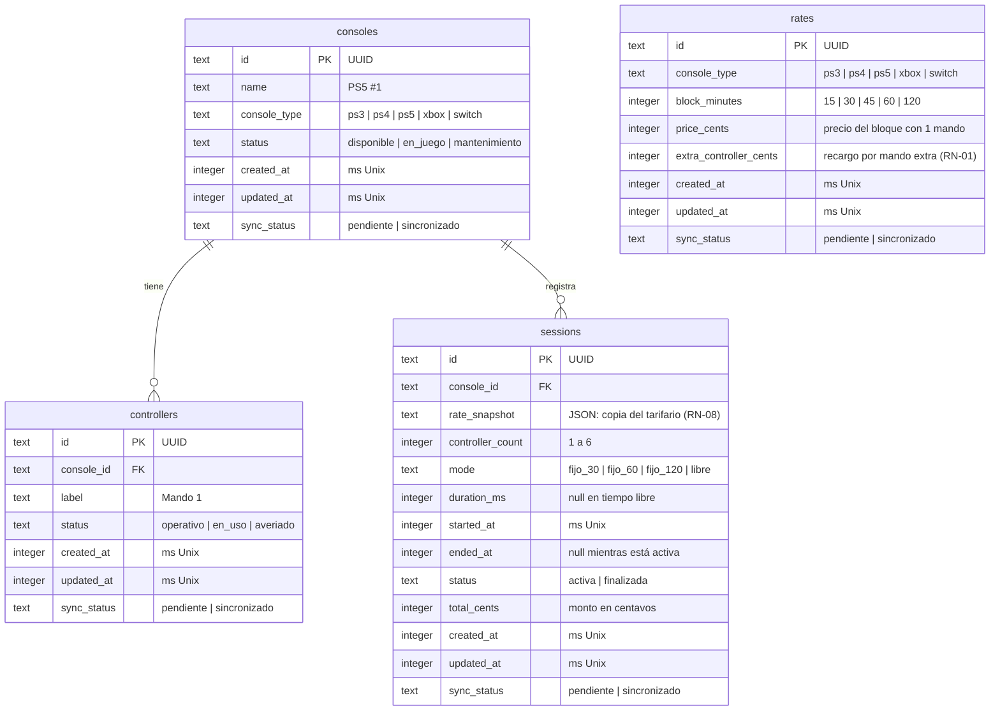

# Modelo de datos · ConsoleControl Mobile

| Campo | Valor |
|---|---|
| Tarea | T03 (TW-3) · Diseñar el esquema SQLite e inicializar datos base |
| Subtarea | TW-22 · Modelo entidad-relación: consolas, mandos, sesiones, tarifas |
| Autor | Victor Maldonado (VM) |
| Fecha | 22/10/2026 |
| Estado | Pendiente de aprobación |
| Alcance | Entidades, relaciones y columnas de la base SQLite local para HU-001 a HU-004, con los campos de sincronización que necesita HU-008 |

## 1. Resumen

La base tiene cuatro tablas: `consoles`, `controllers`, `sessions` y `rates`. Una consola tiene varios mandos y varias sesiones a lo largo del día. El tarifario tiene un precio por tipo de consola y bloque de tiempo, y cada sesión guarda una copia del tarifario de su consola al abrirse (T13). Todas las tablas llevan las mismas columnas de control para el respaldo en Supabase.

## 2. Diagrama entidad-relación

## 3. Entidades

### 3.1. `consoles`

Inventario de consolas del ciber. Es lo que muestra el muro de consolas (TW-7).

| Columna | Tipo | Nulo | Descripción |
|---|---|---|---|
| `id` | TEXT | No | UUID. Clave primaria |
| `name` | TEXT | No | Nombre visible en la tarjeta, por ejemplo «PS5 #1». Único |
| `console_type` | TEXT | No | `ps3`, `ps4`, `ps5`, `xbox` o `switch`. Define la tarifa |
| `status` | TEXT | No | `disponible`, `en_juego` o `mantenimiento` (HU-001, escenarios 1 y 3) |
| `created_at`, `updated_at`, `sync_status` | | | Columnas de control (sección 4) |

### 3.2. `controllers`

Mandos físicos de cada consola. Permiten saber cuántos mandos operativos tiene una consola antes de abrir una sesión (HU-001, escenario 2).

| Columna | Tipo | Nulo | Descripción |
|---|---|---|---|
| `id` | TEXT | No | UUID. Clave primaria |
| `console_id` | TEXT | No | Consola a la que pertenece. Clave foránea a `consoles.id` |
| `label` | TEXT | No | Nombre visible, por ejemplo «Mando 1» |
| `status` | TEXT | No | `operativo`, `en_uso` o `averiado`. Solo los operativos cuentan como stock. Al abrir una sesión pasan a `en_uso` y al cerrarla vuelven a `operativo` (T09) |
| `created_at`, `updated_at`, `sync_status` | | | Columnas de control (sección 4) |

### 3.3. `sessions`

Cada alquiler de una consola. Es la tabla central de HU-001 a HU-004.

| Columna | Tipo | Nulo | Descripción |
|---|---|---|---|
| `id` | TEXT | No | UUID. Clave primaria |
| `console_id` | TEXT | No | Consola alquilada. Clave foránea a `consoles.id` |
| `rate_snapshot` | TEXT (JSON) | No | Copia del tarifario de su tipo de consola al abrir la sesión: una lista de bloques con `blockMinutes`, `priceCents` y `extraControllerCents`. Un cambio de tarifas no afecta a las sesiones en curso (RN-08) |
| `controller_count` | INTEGER | No | Mandos asignados, de 1 a 6 (HU-001) |
| `mode` | TEXT | No | `fijo_30`, `fijo_60`, `fijo_120` o `libre` (HU-001) |
| `duration_ms` | INTEGER | Sí | Duración contratada. Nulo en tiempo libre. La usa `remainingMs` (HU-004) |
| `started_at` | INTEGER | No | Hora de inicio en milisegundos Unix ([ADR 0003](../adr/0003-hora-de-inicio-persistida.md)) |
| `ended_at` | INTEGER | Sí | Hora de cierre. Nulo mientras la sesión está activa |
| `status` | TEXT | No | `activa` o `finalizada` |
| `total_cents` | INTEGER | No | Monto en céntimos. Al abrir se guarda el estimado del tiempo contratado con el motor de tarifas (0 en tiempo libre) y al cerrar, el definitivo |
| `created_at`, `updated_at`, `sync_status` | | | Columnas de control (sección 4) |

### 3.4. `rates`

Tarifario por tipo de consola y bloque de tiempo (HU-003, T13). Las reglas de cobro están en `src/services/tariff.ts`: bloques de 15 min con 3 min de gracia (RN-03), suma de bloques pasada la hora, recargo por mando desde el segundo (RN-01) y 30 % de descuento desde el 4.º mando en Switch y PS5.

| Columna | Tipo | Nulo | Descripción |
|---|---|---|---|
| `id` | TEXT | No | UUID. Clave primaria |
| `console_type` | TEXT | No | `ps3`, `ps4`, `ps5`, `xbox` o `switch` |
| `block_minutes` | INTEGER | No | 15, 30, 45, 60 o 120 minutos |
| `price_cents` | INTEGER | No | Precio del bloque con un mando |
| `extra_controller_cents` | INTEGER | No | Recargo del bloque por cada mando a partir del segundo (RN-01) |
| `created_at`, `updated_at`, `sync_status` | | | Columnas de control (sección 4) |

Restricciones: la pareja (`console_type`, `block_minutes`) es única, `block_minutes` solo admite los cinco bloques y los montos no pueden ser negativos.

## 4. Columnas de control

Todas las tablas tienen las mismas tres columnas para el respaldo unidireccional con Supabase ([ADR 0008](../adr/0008-supabase-respaldo-unidireccional.md)).

| Columna | Tipo | Descripción |
|---|---|---|
| `created_at` | INTEGER | Fecha de creación en milisegundos Unix |
| `updated_at` | INTEGER | Fecha de la última modificación en milisegundos Unix |
| `sync_status` | TEXT | `pendiente` o `sincronizado`. Toda escritura lo deja en `pendiente` |

## 5. Relaciones

| Relación | Cardinalidad | Regla |
|---|---|---|
| `consoles` → `controllers` | 1 a N | Una consola tiene varios mandos; un mando pertenece a una sola consola |
| `consoles` → `sessions` | 1 a N | Una consola tiene muchas sesiones en el tiempo, pero como máximo una `activa` a la vez |
Las claves foráneas no borran en cascada: una consola con sesiones registradas no se elimina, porque esas sesiones son historial de cobro. `sessions` no apunta a `rates`: guarda su propia copia del tarifario (decisión M6).

## 6. Índices

| Tabla | Índice | Para qué |
|---|---|---|
| `controllers` | `console_id` | Contar mandos operativos de una consola |
| `sessions` | `console_id, status` | Encontrar la sesión activa de una consola y restaurar las activas al abrir la app (HU-002) |
| `sessions` | `sync_status` | Buscar pendientes para el respaldo (HU-008) |
| `rates` | `console_type, block_minutes` (único) | Leer el tarifario de un tipo de consola al abrir una sesión |

## 7. Decisiones de diseño

| # | Decisión | Motivo |
|---|---|---|
| M1 | Identificadores UUID de texto en todas las tablas | Se generan sin conexión y no chocan al subir a Supabase |
| M2 | Fechas como INTEGER en milisegundos Unix | Regla del proyecto ([AGENTS.md](../../AGENTS.md)); el tiempo se calcula como `ahora − started_at` |
| M3 | Dinero como INTEGER en centavos | Evita errores de redondeo de los decimales (TW-13) |
| M4 | No se guarda el tiempo transcurrido ni el estado «Tiempo cumplido» | Se calculan con `started_at` y `duration_ms`; un valor guardado quedaría desactualizado al minimizar o reiniciar ([ADR 0003](../adr/0003-hora-de-inicio-persistida.md)) |
| M5 | La sesión guarda `controller_count`, no qué mandos concretos usa. Los mandos prestados se marcan `en_uso` en `controllers` | Como una consola tiene como máximo una sesión activa, al cerrarla se liberan todos sus mandos `en_uso`. Si HU-012 o HU-015 necesitan saber qué mando usó cada sesión, se agrega una tabla `session_controllers` con una migración nueva |
| M6 | La sesión guarda una copia del tarifario de su consola (`rate_snapshot`) y `total_cents`, en lugar de apuntar a `rates` (cambio de T13, migración 0001) | Con el cobro por bloques una sesión usa varias filas del tarifario (75 min = 60 + 15), y por RN-08 un cambio de tarifas (HU-013) no debe afectar a las sesiones en curso ni a las pasadas |
| M7 | Valores de estado en español y en `snake_case` | Siguen el valor `activa` y `pendiente` que ya usa la arquitectura |
| M8 | Sin tabla ni columnas de usuario | Observación O1 ([ADR 0009](../adr/0009-sin-login-en-el-mvp.md)) |

## 7.1. Datos iniciales (provisionales)

Al abrir la app se aplican las migraciones y se cargan los datos de `src/db/seedData.ts` en las tablas vacías (TW-26). Las consolas y mandos solo se cargan si no hay consolas, y las tarifas, si no hay tarifas. Así no se duplica ni se pisa lo que cambie el administrador, y la migración 0001 de T13 puede vaciar el tarifario anterior.

Los datos son **provisionales**: una consola por tipo con 4 mandos cada una, y las tarifas del CSV del documento de T12 «Tarifas base y regla de recargo por mando adicional», pendientes de confirmar con JS (pregunta P1). Precios en soles, con un mando; entre paréntesis, el recargo por mando extra:

| Tipo | 15 min | 30 min | 45 min | 1 h | 2 h |
|---|---|---|---|---|---|
| PS3 | 1.50 (0.50) | 2.50 (1.00) | 4.00 (1.50) | 5.00 (2.00) | 9.00 (3.50) |
| PS4 | 2.00 (1.00) | 3.50 (1.50) | 5.50 (2.50) | 7.00 (3.00) | 13.00 (5.50) |
| Switch | 2.00 (1.00) | 4.00 (2.00) | 6.00 (3.00) | 8.00 (3.50) | 15.00 (6.50) |
| PS5 | 2.50 (1.50) | 5.00 (2.50) | 7.50 (3.50) | 10.00 (4.50) | 19.00 (8.50) |
| Xbox | 2.50 (1.50) | 5.00 (2.50) | 7.50 (3.50) | 10.00 (4.50) | 19.00 (8.50) |

Para cambiarlos basta con editar `src/db/seedData.ts` y los montos esperados de `__tests__/services/tariff.test.ts`. En un celular donde la app ya se abrió, los datos nuevos solo se cargan después de borrar los datos de la app.

## 7.2. Prueba de persistencia (TW-28)

Comprueba el criterio de T03 «Una sesión guardada sobrevive al cierre de la app». Se hace en el celular con Expo Go, desde la pantalla de diagnóstico `app/dev/persistencia.tsx`, que solo existe en desarrollo (enlace «Prueba de persistencia» en la pantalla inicial).

| # | Paso | Resultado esperado |
|---|---|---|
| 1 | Abrir la pantalla de diagnóstico | 5 consolas, 20 mandos operativos, 25 tarifas y 0 sesiones activas (en una instalación nueva; antes de T13 eran 4, 16 y 16) |
| 2 | Pulsar «Crear sesión de prueba» | 1 sesión activa con su hora de inicio |
| 3 | Cerrar la app por completo desde el selector de apps recientes y esperar 2 minutos | |
| 4 | Reabrir la app y volver a la pantalla de diagnóstico | La misma sesión sigue activa, con la misma hora de inicio y «hace 2 min» o más |
| 5 | Pulsar «Recargar» de nuevo | Los datos iniciales no se duplicaron: siguen las mismas cantidades del paso 1 |
| 6 | Pulsar «Finalizar sesiones activas» | 0 sesiones activas |

## 8. Preguntas abiertas

| # | Pregunta | A quién |
|---|---|---|
| P1 | El documento de T12 trae dos juegos de precios que no coinciden: sus tablas (por ejemplo, PS4 1 h = S/ 5.00) y su CSV (PS4 1 h = S/ 7.00). Sus casos C4 y C8 también dan montos distintos en la tabla y en los «ejemplos de lectura». Se usa el CSV, que coincide con los ejemplos de lectura. ¿Cuál es el correcto? | JS (T12) |
| P2 | ~~En tiempo libre, ¿se cobra por hora completa, por fracción o por minuto?~~ Resuelta por T12: bloques de 15 min con 3 min de gracia | — |
| P3 | Consolas y mandos reales del local. T12 menciona PS3, PS4, Switch y PS5 en un lugar, y además Xbox en su CSV. Se dejan los cinco tipos | JS |
| P5 | Máximo de mandos por sesión: T12 dice 8 en un lugar y 6 en `reglas.csv`. HU-001 y la app usan 6 | JS |
| P6 | `calculateRate` recibe minutos enteros. Al cerrar la sesión (HU-005) habrá que pasar el tiempo jugado a minutos: ¿minutos completos (12 min 50 s = 12) o iniciados (= 13)? Cambia el bloque solo cerca de los límites de la gracia | JS |
| P4 | Jira pide este documento en `docs/base-de-datos.md`; se ubica en `docs/architecture/` para seguir la estructura de `docs/` | VN |

## 9. Aprobación

| Sigla | Nombre | Rol | Aprobado | Fecha |
|---|---|---|---|---|
| JS | Juan Salas | UI/UX y análisis | ☐ | |
| RF | Rodrigo Ferdinand Quispe | Frontend | ☐ | |
| VM | Victor Maldonado | Backend y base de datos | ☐ | |
| VN | Victor Narciso Mamani Anahua | Arquitectura y jefe de proyecto | ☐ | |
