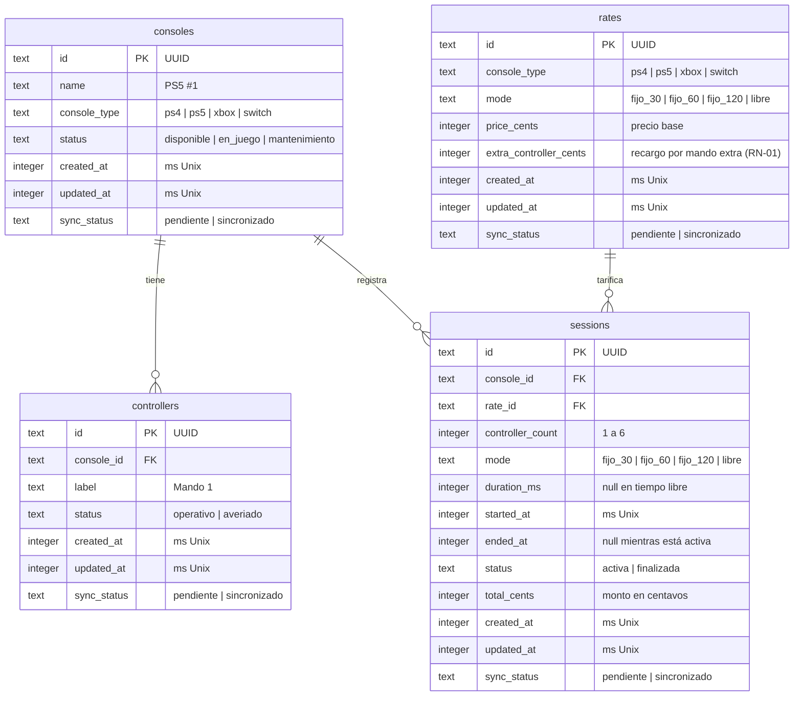

# Modelo de datos · ConsoleControl Mobile

| Campo | Valor |
|---|---|
| Tarea | T03 (TW-3) · Diseñar el esquema SQLite e inicializar datos base |
| Subtarea | TW-22 · Modelo entidad-relación: consolas, mandos, sesiones, tarifas |
| Autor | Victor Maldonado (VM) |
| Fecha | 22/10/2026 |
| Estado | Pendiente de aprobación |
| Alcance | Entidades, relaciones y columnas de la base SQLite local para HU-001 a HU-004, con los campos de sincronización que necesita HU-008 |

## 1. Resumen

La base tiene cuatro tablas: `consoles`, `controllers`, `sessions` y `rates`. Una consola tiene varios mandos y varias sesiones a lo largo del día; una sesión usa la tarifa vigente de su tipo de consola y modalidad. Todas las tablas llevan las mismas columnas de control para el respaldo en Supabase.

## 2. Diagrama entidad-relación

## 3. Entidades

### 3.1. `consoles`

Inventario de consolas del ciber. Es lo que muestra el muro de consolas (TW-7).

| Columna | Tipo | Nulo | Descripción |
|---|---|---|---|
| `id` | TEXT | No | UUID. Clave primaria |
| `name` | TEXT | No | Nombre visible en la tarjeta, por ejemplo «PS5 #1». Único |
| `console_type` | TEXT | No | `ps4`, `ps5`, `xbox` o `switch`. Define la tarifa |
| `status` | TEXT | No | `disponible`, `en_juego` o `mantenimiento` (HU-001, escenarios 1 y 3) |
| `created_at`, `updated_at`, `sync_status` | | | Columnas de control (sección 4) |

### 3.2. `controllers`

Mandos físicos de cada consola. Permiten saber cuántos mandos operativos tiene una consola antes de abrir una sesión (HU-001, escenario 2).

| Columna | Tipo | Nulo | Descripción |
|---|---|---|---|
| `id` | TEXT | No | UUID. Clave primaria |
| `console_id` | TEXT | No | Consola a la que pertenece. Clave foránea a `consoles.id` |
| `label` | TEXT | No | Nombre visible, por ejemplo «Mando 1» |
| `status` | TEXT | No | `operativo` o `averiado`. Solo los operativos cuentan como stock |
| `created_at`, `updated_at`, `sync_status` | | | Columnas de control (sección 4) |

### 3.3. `sessions`

Cada alquiler de una consola. Es la tabla central de HU-001 a HU-004.

| Columna | Tipo | Nulo | Descripción |
|---|---|---|---|
| `id` | TEXT | No | UUID. Clave primaria |
| `console_id` | TEXT | No | Consola alquilada. Clave foránea a `consoles.id` |
| `rate_id` | TEXT | No | Tarifa aplicada al abrir la sesión. Clave foránea a `rates.id` |
| `controller_count` | INTEGER | No | Mandos asignados, de 1 a 6 (HU-001) |
| `mode` | TEXT | No | `fijo_30`, `fijo_60`, `fijo_120` o `libre` (HU-001) |
| `duration_ms` | INTEGER | Sí | Duración contratada. Nulo en tiempo libre. La usa `remainingMs` (HU-004) |
| `started_at` | INTEGER | No | Hora de inicio en milisegundos Unix ([ADR 0003](../adr/0003-hora-de-inicio-persistida.md)) |
| `ended_at` | INTEGER | Sí | Hora de cierre. Nulo mientras la sesión está activa |
| `status` | TEXT | No | `activa` o `finalizada` |
| `total_cents` | INTEGER | No | Monto en centavos. Se guarda el estimado al abrir (TW-14) y el definitivo al cerrar |
| `created_at`, `updated_at`, `sync_status` | | | Columnas de control (sección 4) |

### 3.4. `rates`

Tarifario por tipo de consola y modalidad (HU-003).

| Columna | Tipo | Nulo | Descripción |
|---|---|---|---|
| `id` | TEXT | No | UUID. Clave primaria |
| `console_type` | TEXT | No | `ps4`, `ps5`, `xbox` o `switch` |
| `mode` | TEXT | No | `fijo_30`, `fijo_60`, `fijo_120` o `libre` |
| `price_cents` | INTEGER | No | Precio base con un mando. En tiempo libre, precio por hora |
| `extra_controller_cents` | INTEGER | No | Recargo por cada mando a partir del segundo (RN-01) |
| `created_at`, `updated_at`, `sync_status` | | | Columnas de control (sección 4) |

Restricción: la pareja (`console_type`, `mode`) es única.

## 4. Columnas de control

Todas las tablas tienen las mismas tres columnas para el respaldo unidireccional con Supabase ([ADR 0008](../adr/0008-supabase-respaldo-unidireccional.md)).

| Columna | Tipo | Descripción |
|---|---|---|
| `created_at` | INTEGER | Fecha de creación en milisegundos Unix |
| `updated_at` | INTEGER | Fecha de la última modificación en milisegundos Unix |
| `sync_status` | TEXT | `pendiente` o `sincronizado`. Toda escritura lo deja en `pendiente` |

## 5. Relaciones

| Relación | Cardinalidad | Regla |
|---|---|---|
| `consoles` → `controllers` | 1 a N | Una consola tiene varios mandos; un mando pertenece a una sola consola |
| `consoles` → `sessions` | 1 a N | Una consola tiene muchas sesiones en el tiempo, pero como máximo una `activa` a la vez |
| `rates` → `sessions` | 1 a N | Una tarifa se aplica a muchas sesiones |

Las claves foráneas no borran en cascada: una consola o una tarifa con sesiones registradas no se elimina, porque esas sesiones son historial de cobro.

## 6. Índices

| Tabla | Índice | Para qué |
|---|---|---|
| `controllers` | `console_id` | Contar mandos operativos de una consola |
| `sessions` | `console_id, status` | Encontrar la sesión activa de una consola y restaurar las activas al abrir la app (HU-002) |
| `sessions` | `sync_status` | Buscar pendientes para el respaldo (HU-008) |
| `rates` | `console_type, mode` (único) | Buscar la tarifa al abrir una sesión |

## 7. Decisiones de diseño

| # | Decisión | Motivo |
|---|---|---|
| M1 | Identificadores UUID de texto en todas las tablas | Se generan sin conexión y no chocan al subir a Supabase |
| M2 | Fechas como INTEGER en milisegundos Unix | Regla del proyecto ([AGENTS.md](../../AGENTS.md)); el tiempo se calcula como `ahora − started_at` |
| M3 | Dinero como INTEGER en centavos | Evita errores de redondeo de los decimales (TW-13) |
| M4 | No se guarda el tiempo transcurrido ni el estado «Tiempo cumplido» | Se calculan con `started_at` y `duration_ms`; un valor guardado quedaría desactualizado al minimizar o reiniciar ([ADR 0003](../adr/0003-hora-de-inicio-persistida.md)) |
| M5 | La sesión guarda `controller_count`, no qué mandos concretos usa | Basta para HU-001 a HU-004. Si HU-012 o HU-015 necesitan mandos concretos, se agrega una tabla `session_controllers` con una migración nueva |
| M6 | La sesión guarda `rate_id` y `total_cents` | Si el tarifario cambia (HU-013), las sesiones pasadas conservan el monto que se cobró |
| M7 | Valores de estado en español y en `snake_case` | Siguen el valor `activa` y `pendiente` que ya usa la arquitectura |
| M8 | Sin tabla ni columnas de usuario | Observación O1 ([ADR 0009](../adr/0009-sin-login-en-el-mvp.md)) |

## 8. Preguntas abiertas

| # | Pregunta | A quién |
|---|---|---|
| P1 | Tarifario real: precio por tipo de consola y modalidad, y recargo por mando extra | JS (T12) |
| P2 | En tiempo libre, ¿se cobra por hora completa, por fracción o por minuto? | JS (T12) |
| P3 | Cantidad real de consolas y de mandos por consola en el local, para los datos iniciales (TW-26) | JS |
| P4 | Jira pide este documento en `docs/base-de-datos.md`; se ubica en `docs/architecture/` para seguir la estructura de `docs/` | VN |

## 9. Aprobación

| Sigla | Nombre | Rol | Aprobado | Fecha |
|---|---|---|---|---|
| JS | Juan Salas | UI/UX y análisis | ☐ | |
| RF | Rodrigo Ferdinand Quispe | Frontend | ☐ | |
| VM | Victor Maldonado | Backend y base de datos | ☐ | |
| VN | Victor Narciso Mamani Anahua | Arquitectura y jefe de proyecto | ☐ | |
